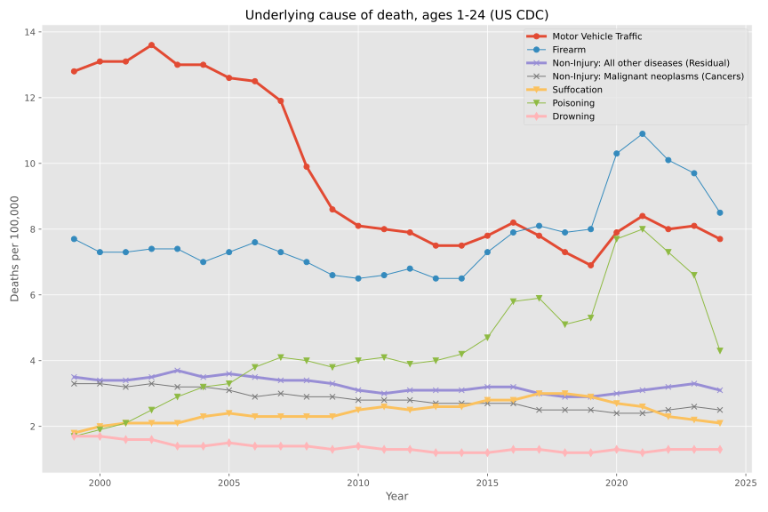
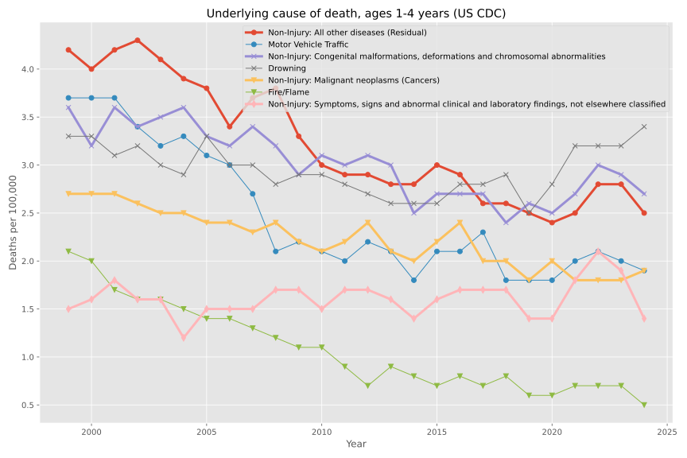
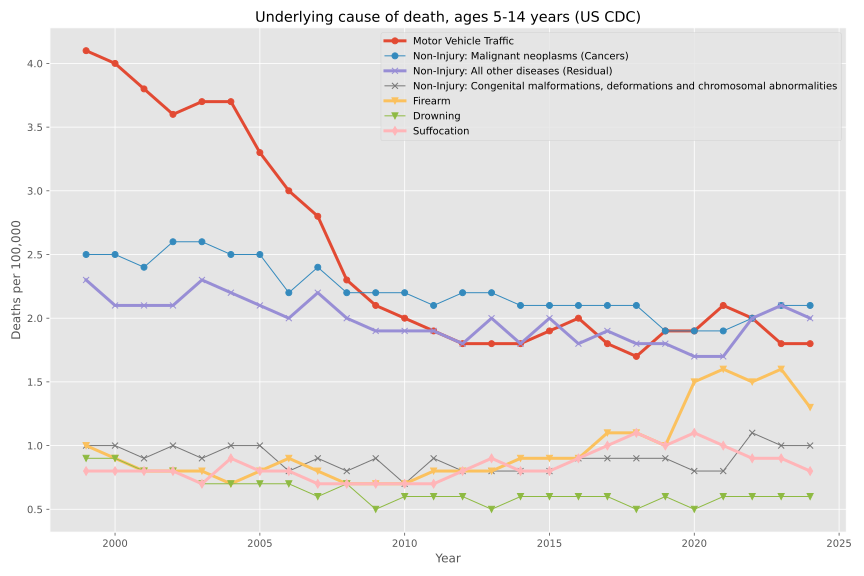
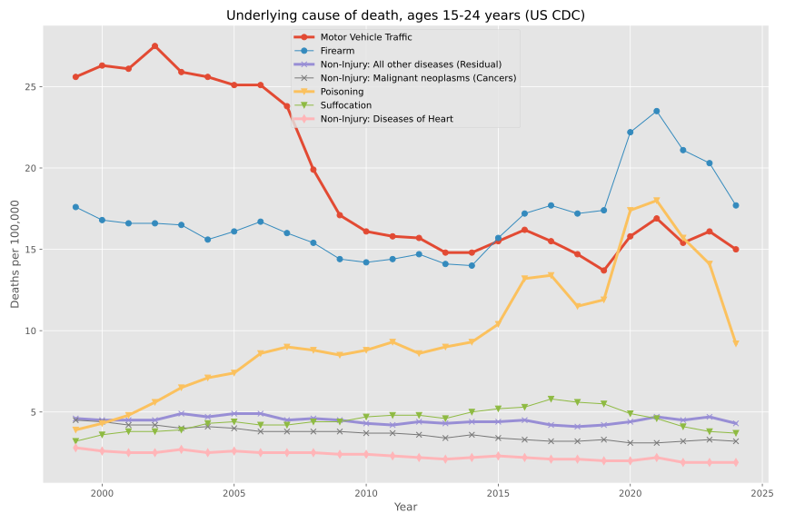
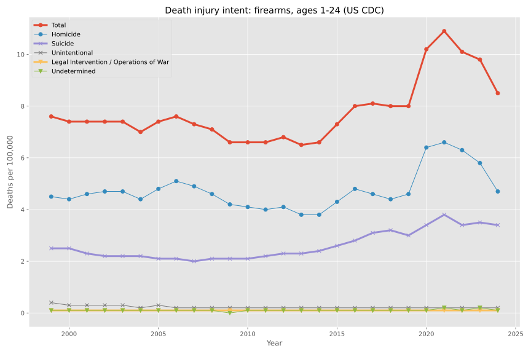

The Economist [tweeted](https://nitter.it/TheEconomist/status/1529545402818695169) this chart of gun vs motor deaths over the last twenty years, as of 2022, in the US:  (change `nitter.it` to the latest link; [Economist article](https://www.economist.com/graphic-detail/2022/05/25/guns-are-the-things-most-likely-to-kill-young-people-in-america))

## 1-24 years old

> CDC links: [1999–2020](https://wonder.cdc.gov/controller/saved/D76/D292F582), [2018–2024](https://wonder.cdc.gov/controller/saved/D158/D525F242) (the new query is split by age group, and the three groups are summed for this chart)

Expanding the Economist's chart (1-24 year old underlying causes of death), this shows the top seven causes of death: motor vehicle, firearm, "all other diseases", cancer, suffocation, poisoning, and drowning.

The motor vehicle line hovered high above everything else from 1999 to 2007 around 12–13.5 deaths per 100,000 but crashed to ~8 since 2010.

Meanwhile, the firearm line hovered ~7 since 1999 but around 2015 began climbing, exceeding the motor vehicles line around 2017 and jumping above 10 deaths per 100,000 in 2020, peaking at 10.9 in 2021. It has fallen since, to 8.5 in 2024, still above motor vehicles (7.7).

The other unusual line is poisoning. In 1999 it was the among the lowest, at <2 per 100,000 deaths but steadily increased, spiked to 8.0 in 2021 (right at motor vehicles), and then dropped sharply to 4.3 in 2024.

Most of the other lines show secular downward trends from 3.5 deaths or less, except suffocation which has risen from ~2 to 3 (note that SIDS was recently cured).

## 1-4 years old

> CDC links for this and the remaining age-group charts: [1999–2020](https://wonder.cdc.gov/controller/saved/D76/D292F592), [2018–2024](https://wonder.cdc.gov/controller/saved/D158/D525F242)

A messy chart of the top seven causes of death in the US for ages 1-4 years old. All lines are <3.5 deaths per 100,000 as of 2024: drowning, congenital birth defects, "all other diseases", motor vehicles, cancer, "other" abnormal clinical non-injury deaths, and (new to the top seven) infectious diseases, which rose from ~0.6 in 2015 to 1.6 in 2022. Most lines are flat or falling, but drowning has been rising since 2019 (2.5 to 3.4), and is the leading cause of death at this age.

## 5-14 years old

A banger chart of causes of death, 5-14 years old.

There are three groups of lines.

Like the 1-4 years old, the worst line began at ~4 deaths per 100,000 in the late 90s. That was motor vehicle deaths. It has crashed to <2 deaths per 100,000 (1.8 in 2024).

The next bundle has two lines: cancer and "other" diseases that began at ~2.5 in 1999 and have gently fallen to <2 per 100,000, both close to motor vehicle deaths.

Then the last bundle is four other causes of death (congenital defects, firearm, drowning, and suffocation), around 0.75 to 1 death per 100,000, largely flat over the decades, though suffocation briefly rose to ~1.1 (2020) before falling back to 0.8, and, very worryingly, firearms shot up from ~1 to 1.5–1.6 deaths per 100,000 in 2020–2023, ahead of drowning, suffocation and congenital defects and close behind motor vehicles. In 2024 firearms fell to 1.3.

This is on the whole good news compared to the original Economist chart. Most kids and early teens don't die in the US.

## 15-24 years old

Dramatic chart of causes of deaths for 15-24 year olds.

Motor vehicle deaths was the #1 killer at 25 to 27 deaths per 100,000 in the early 2000s. It has crashed to ~15 starting in the late 2000s.

Firearm deaths is the next very worrying cause of death. It slowly descended from 17 to 14 deaths per 100,000 from 1999 to 2014 but since then rose to 22 in 2020 and a peak of 23.5 in 2021, exceeding motor vehicles every year since 2015. It has fallen since to 17.7 in 2024, still above motor vehicles.

The other worrying trend is #3, poisoning, which was one of the lowest lines in the chart in 1999 but steadily increased from ~4 to 18 in 2021, beating motor vehicle deaths in 2020 and 2021. Then it fell sharply: 14.1 in 2023 and 9.2 in 2024, below motor vehicles (15.0) and firearms (17.7).

The other four lines ("all other diseases", cancer, suffocation, and heart disease") are all between 2~5 deaths per 100,000.

## Firearms: injury intent (homicide, suicide, etc)

> CDC links for data: [1999–2020](https://wonder.cdc.gov/controller/saved/D76/D292F612), [2018–2024](https://wonder.cdc.gov/controller/saved/D158/D525F243)

The firearms line of the first chart broken down into all the injury intents. Roughly twice as many homicides as suicides over much of the data horizon, but worryingly suicides bottomed in 2007 at 2 deaths per 100,000 and have steadily increased to a peak of 3.8 in 2021 (3.4 in 2024). Meanwhile, homicides bottomed much later, in 2013-2014, at less than 4 deaths per 100,000, jumped to 6.4–6.6 in 2020–2021 and have fallen since to 4.7 in 2024, almost back to the pre-2020 level.

Meanwhile unintentional firearm deaths are quite rare (less than 0.3 deaths per 100,000).

## Data notes

Data covers 1999–2024. 1999–2017 are from CDC WONDER's 1999–2020 database (the files with `1999-2020` in the name), and 2018–2024 from the newer single-race database (`2018-2024` files); the saved queries for both are linked under each chart. For 2018–2020, where the two overlap, deaths, populations, and rates agree exactly. The 1-24 chart is built by summing the three age groups in the new data. Death counts below 10 are suppressed in the new data, which only affects minor causes.
